# PITUAH.iaf Home Page

An internal IT portal for one place to reach everything: app shortcuts, support tickets, team chat, host monitoring and an in-browser SSH console. It also pulls in requests and conversations from your other support and chat apps through an API.

It runs as a single Docker container and needs no internet access, so it works on an air-gapped network.

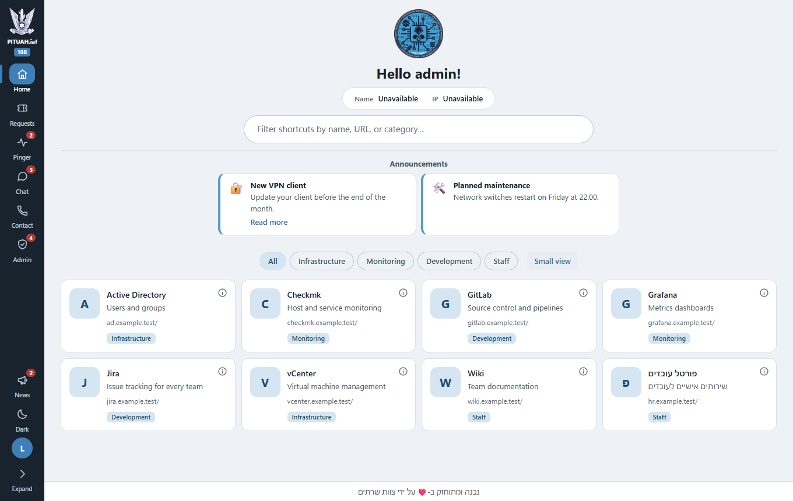

## Contents

- [Screenshots](#screenshots)
- [Features](#features)
- [Quick start](#quick-start)
- [How it works](#how-it-works)
- [Protocols](#protocols)
- [Sign-in and permissions](#sign-in-and-permissions)
- [Data storage](#data-storage)
- [Connecting other apps](#connecting-other-apps)
- [API overview](#api-overview)
- [Configuration](#configuration)
- [Deployment](#deployment)
- [Security](#security)
- [Performance](#performance)
- [Project layout](#project-layout)
- [Local development](#local-development)
- [Known limits](#known-limits)

## Screenshots

| | |
|---|---|
| 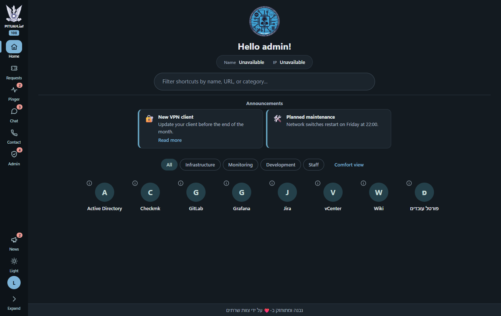 **Home, dark theme**, with the sidebar's notification badges | 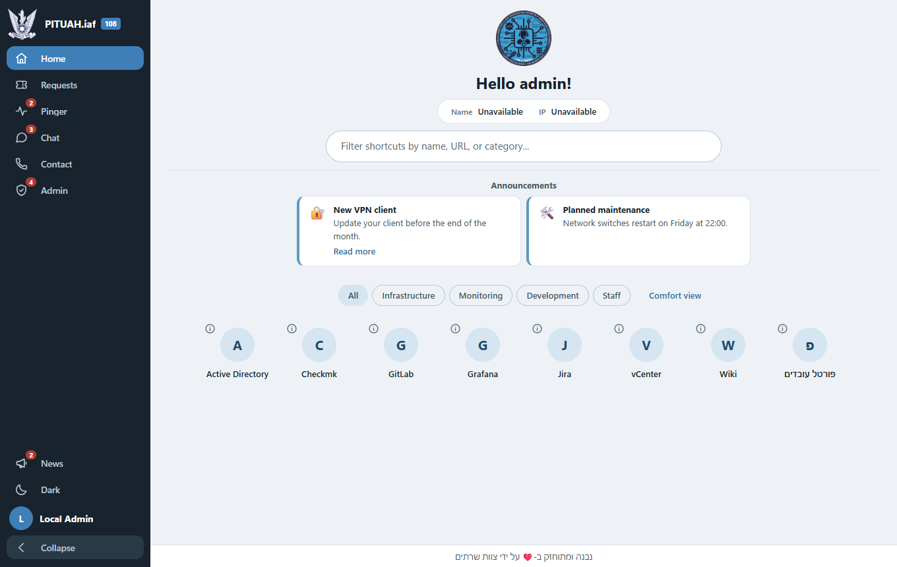 **Expanded sidebar** |
| 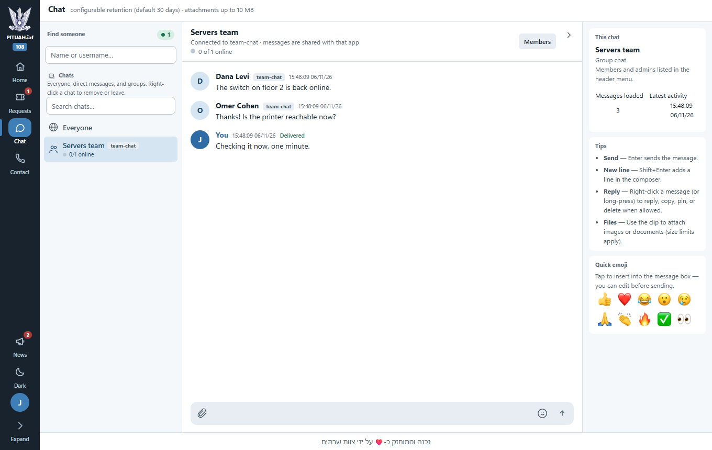 **Chat** with a conversation connected to another platform | 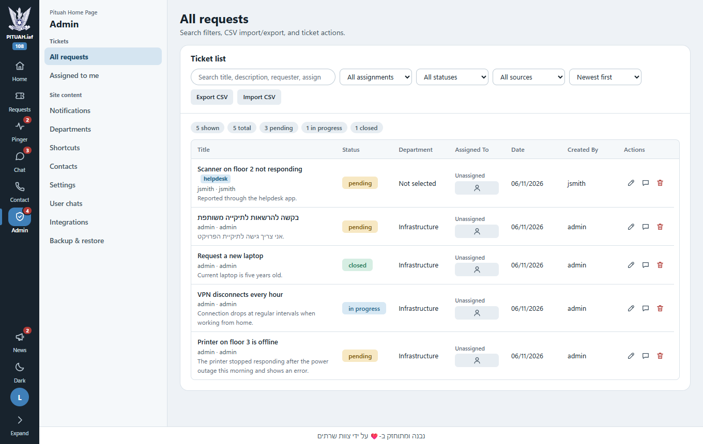 **All requests**, including requests from other apps |
| 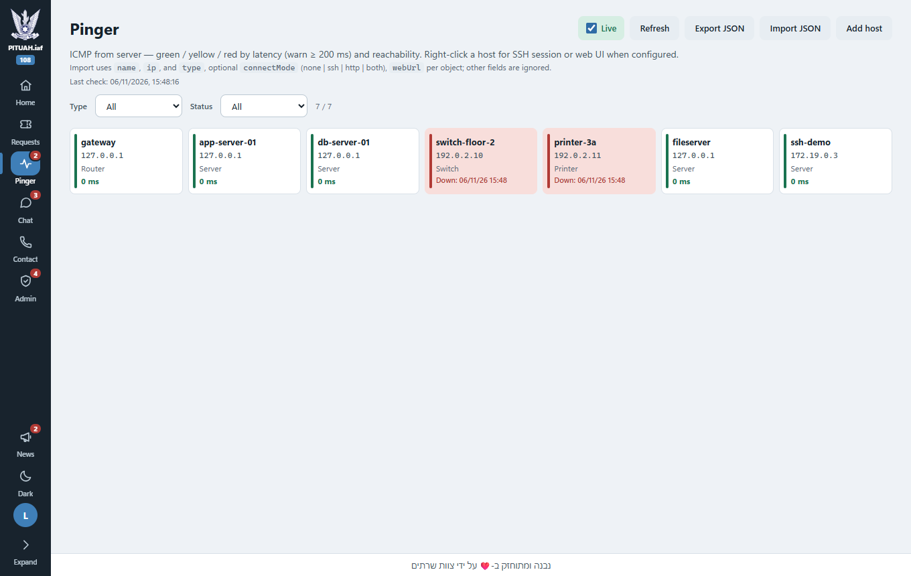 **Pinger** host monitoring | 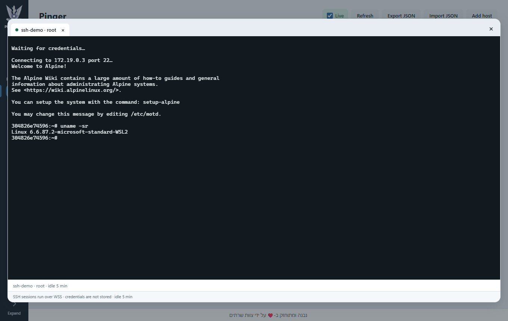 **In-browser SSH console** |
| 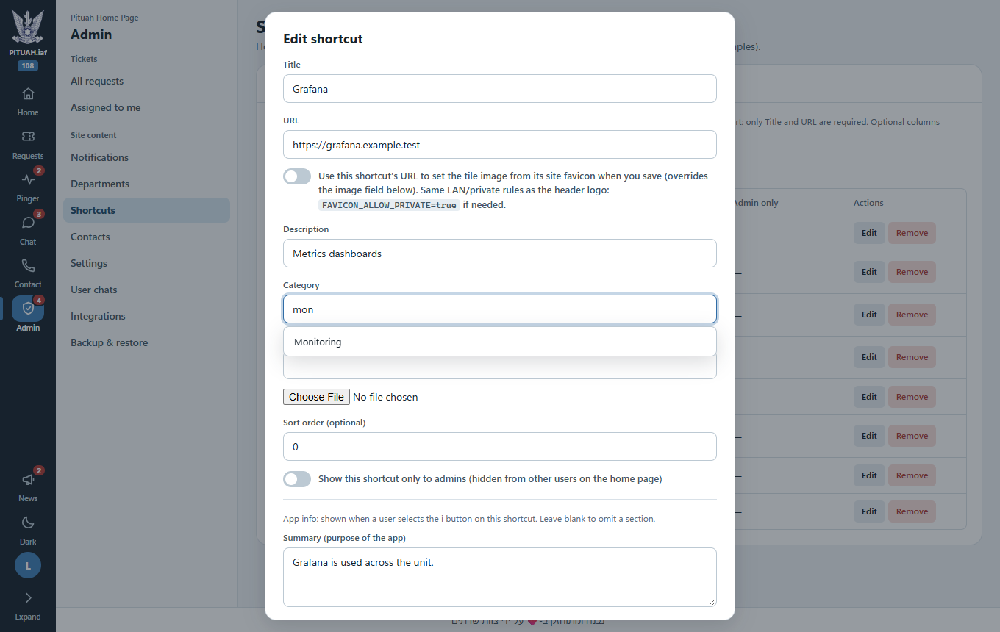 **Shortcut editor** with the category dropdown | 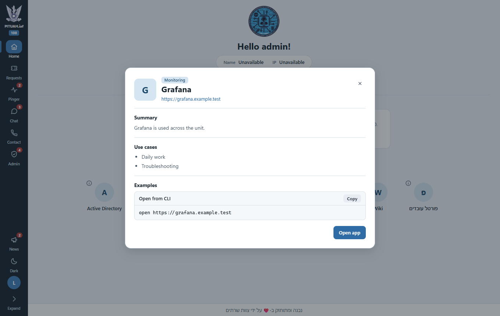 **App info**, from the "i" on each shortcut |
| 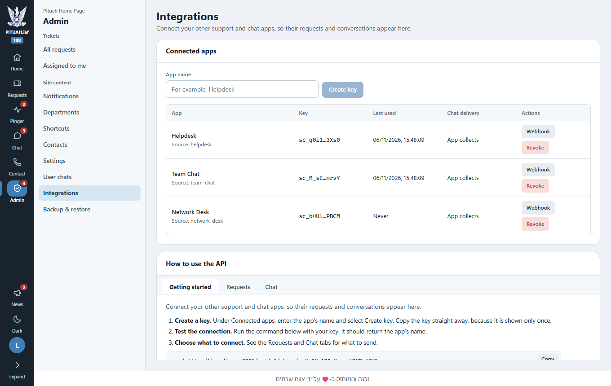 **Integrations**, with API keys and the built-in API guide | 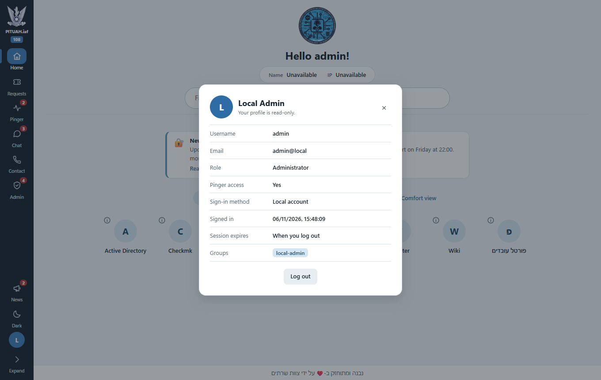 **Read-only profile** |

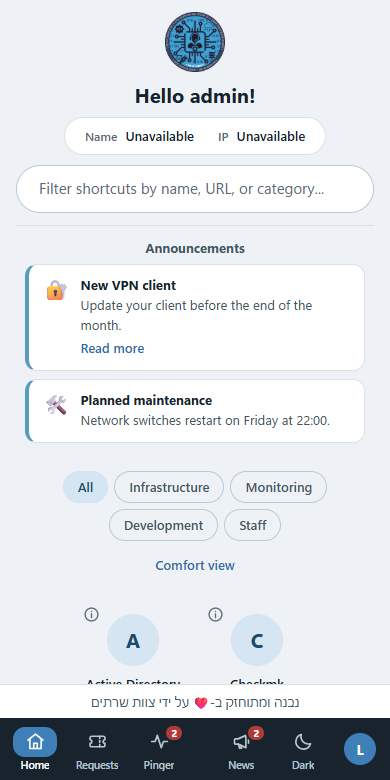

## Features

**Home page**
- Shortcut tiles with search, category filters, favorites, and small or comfort views.
- An "i" button on each shortcut shows its summary, use cases and examples.
- Admins can right-click a shortcut to edit it.
- Shows the visitor's computer name and IP address, plus announcements and the message of the day.
- The search bar stays in place while the shortcuts scroll.

**Tickets**
- Users open, edit and comment on their own requests.
- Admins see everything, filter by assignment, status and source, assign tickets, and import or export CSV.
- Requests from other apps appear in the same list, labeled with their source and linked to the original.

**Chat**
- An Everyone channel, direct messages and group chats.
- Replies, reactions, pinned messages, read receipts, typing indicators, online status and text file attachments.
- Two-way connections to other chat platforms, with delivery status on each message.
- Messages are deleted after a configurable retention period, 30 days by default.

**Pinger and SSH**
- Pings a list of hosts from the server and shows them as up, slow or down, with import and export as JSON.
- Hosts can open an in-browser SSH terminal with host key checking and saved commands for each host type, or their web interface.
- Admins can manage hosts. Members of a configured directory group get read-only access.

**Admin dashboard**
- Tickets, announcements, departments, shortcuts and contacts.
- Settings for branding, message of the day and all integrations, without editing files.
- A read-only audit view of a user's chats, API keys for connected apps, and full backup and restore.

**Interface**
- Light and dark themes that follow the system until a user picks one.
- An expandable sidebar with live badges for down hosts, open tickets and unread chats.
- Works on phones, where the sidebar becomes a bottom bar.

## Quick start

You need Docker with Docker Compose.

1. Create your settings file, then set `LOCAL_ADMIN_PASSWORD` in it:

   ```bash
   cp .env.example .env
   ```

2. Build and start the app:

   ```bash
   docker compose up --build -d
   ```

3. Open **http://localhost:8080** and sign in as `admin` with the password you set.

To use a different port, set `HOST_PORT`. Everything else can be configured under **Admin → Settings**.

## How it works

The container runs one Node.js process. It serves the built React app and the API from the same address, so there is no separate web server to run.

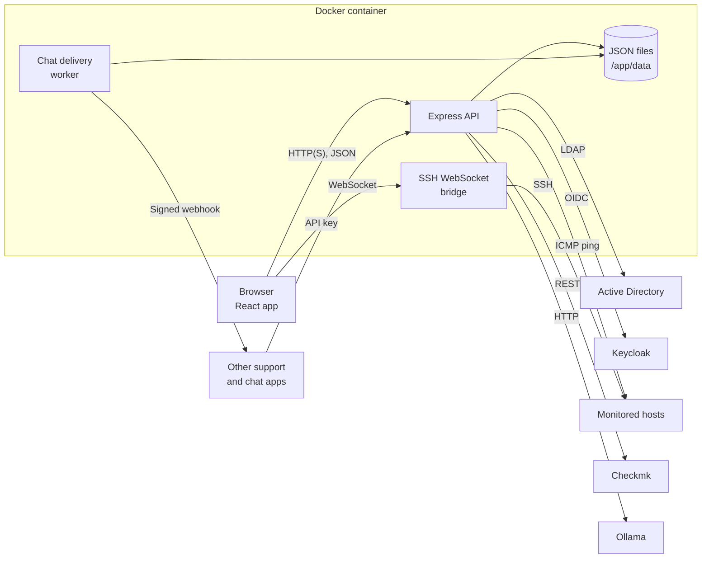

Only the browser and Docker are required. Every outside service is optional, and the app keeps working when one is unavailable.

### What happens on a request

1. The React app calls `/api/...` and sends its sign-in token in the `Authorization` header.
2. Express applies the security headers, then checks the token and the user's role on that route.
3. The route reads or changes a JSON collection through the data store.
4. The response returns as JSON. Display names are looked up in the directory when it's available, with a short timeout, and fall back to login names.

### Live updates

The app has no push channel for ordinary pages, so the browser checks for changes:

| What | How often |
|---|---|
| Unread chat count | Every 20 seconds, and when the window regains focus |
| Open tickets and hosts down | Every 30 seconds, when the page changes, and on focus |
| Pinger results | Cached on the server for 25 seconds, to avoid flooding the network with pings |

### Computer name and IP address

The IP address comes from the visitor's connection. Behind a reverse proxy, turn on `TRUST_PROXY` so it's read from `X-Forwarded-For`.

A browser never reveals its computer's name, so the name comes from a reverse DNS lookup of that address. It needs PTR records on your DNS server, otherwise it shows **Unavailable**. It also shows as unavailable when Docker hides the real address, as on Docker Desktop when you browse from the same computer.

## Protocols

| Protocol | Used for | Direction | Security |
|---|---|---|---|
| **HTTP(S) and JSON** | The web app and API | Browser to app | TLS at the ingress or proxy, with a signed token on each call |
| **WebSocket** | SSH terminal, at `/api/pinger/ssh-ws` | Browser to app | Token checked on connection, and Pinger access required |
| **SSH** | Terminal sessions | App to host | Password or private key that is never stored, with host key checking |
| **ICMP** | Host checks, through the system `ping` command | App to host | Addresses are validated before use |
| **LDAP** | Directory sign-in, groups and display names | App to Active Directory | Bind account set in settings |
| **OIDC** (Authorization Code) | Single sign-on | Browser, app and Keycloak | Signed `state` value to block forged callbacks |
| **Kerberos / SPNEGO** | Passwordless sign-in | Browser to Keycloak | Handled by Keycloak, not this app |
| **REST** | Down hosts from Checkmk | App to Checkmk | Automation user and secret as a Bearer token |
| **HTTP** | Message of the day text from Ollama | App to Ollama | Stays on your network |
| **Webhook** (HTTP POST) | Sending chat messages to other platforms | App to your connector | HMAC-SHA256 signature on every call |

## Sign-in and permissions

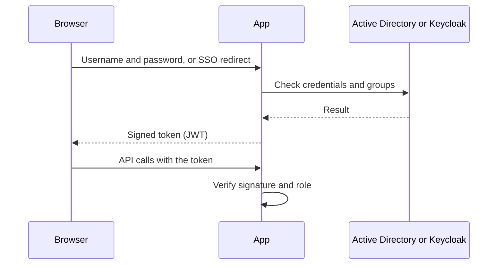

There are three ways to sign in:

1. **Local admin:** one account set in configuration, always an administrator and never checked against the directory. It's the way in when the directory is down.
2. **Directory:** LDAP against Active Directory. Membership of `LDAP_ADMIN_GROUP_DN` grants admin, and `LDAP_PINGER_GROUP_DN` grants Pinger access.
3. **Single sign-on:** OIDC through Keycloak, which can use Kerberos for passwordless sign-in. It runs automatically when Keycloak is reachable.

After signing in, the browser keeps a signed JWT in `localStorage` and sends it with each request.

| Action | Visitor | User | Pinger member | Admin |
|---|---|---|---|---|
| Shortcuts, contacts, Everyone channel (read) | ✓ | ✓ | ✓ | ✓ |
| Chat, own tickets, favorites, profile | | ✓ | ✓ | ✓ |
| View Pinger, use SSH | | | ✓ | ✓ |
| Change Pinger hosts | | | | ✓ |
| Admin dashboard, all tickets, settings, API keys | | | | ✓ |

## Data storage

Data is stored as JSON files in `/app/data`, with one file per collection. There is no database to install.

| Collection | Holds |
|---|---|
| `users`, `settings` | Accounts seen at sign-in, and app settings |
| `tickets`, `departments` | Support requests and departments |
| `shortcuts`, `notifications`, `servers` | Home page content |
| `chatConversations`, `chatMessages`, `chatReads`, `chatPresence`, `chatHiddenConversations`, `chatAttachments`, `lobbyChat` | Chat |
| `pingerHosts`, `pingerSshHostKeys` | Monitored hosts and trusted SSH host keys |
| `integrationKeys`, `chatOutbox` | Connected apps, and chat messages waiting for delivery |

The store keeps data safe and fast in these ways:

- **Safe writes:** each write goes to a temporary file that then replaces the original, so a crash can't leave a half-written file.
- **No lost updates:** writes to a collection run one at a time. A load test with 300 simultaneous new tickets stored all 300.
- **Fast reads:** parsed data is kept in memory and reused until the file changes. Chat messages also have a per-conversation index.

Uploaded files are in `/app/data/uploads`. **Admin → Backup & restore** exports all of it as one ZIP file.

## Connecting other apps

Create an API key for each app under **Admin → Integrations**. That page also has a step-by-step guide with examples for your server's address.

- **[Requests API](docs/REQUESTS_API.md):** other support apps send requests here, and they appear with your own tickets.
- **[Chat API](docs/CHAT_API.md):** groups and chats from other platforms appear here, and messages written here are sent back.

Each app needs a small connector, a service or bot that calls this API and talks to that app. How chat delivery works:

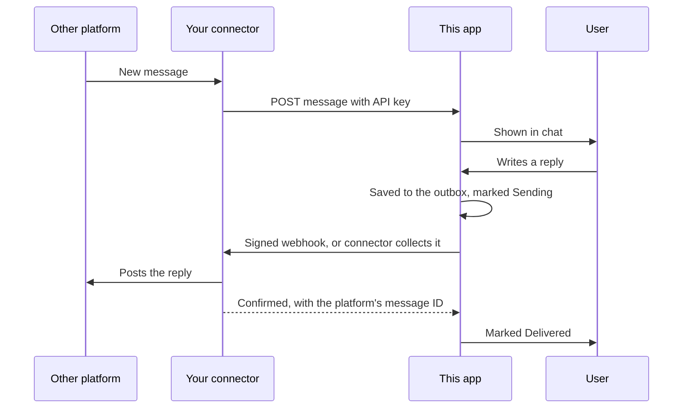

Retries, message order and duplicates are handled for you:

- **Retries:** failed deliveries retry for about two hours, then show as **Not delivered**. The outbox survives restarts.
- **Order:** a message that is retrying holds back later ones in its conversation.
- **No loops:** messages from another platform are never sent back to it, and an echo with a known ID is ignored.
- **Separation:** the API key decides the source, so an app can only reach what it created. Outside authors are stored with the app's name as a prefix, so they can't pose as local users.

## API overview

All addresses start with `/api`. These are the main groups.

| Group | Addresses | Access |
|---|---|---|
| Sign-in | `POST /login`, `/auth/sso/*`, `GET /profile` | Public, or signed in for the profile |
| Tickets | `/tickets/requests`, `/tickets/open-count`, `/tickets/import` | Own tickets, or all for admins |
| Chat | `/chat/conversations`, `/chat/messages`, `/chat/attachments`, `/chat/directory` | Signed in and a member of the conversation |
| Home content | `/shortcuts`, `/notifications`, `/departments`, `/settings/public`, `/settings/system-info`, `/motd` | Public to read, admin to change |
| Pinger | `/pinger/status`, `/pinger/hosts`, `/pinger/ssh-fingerprint` | Pinger access, admin to change |
| Administration | `/users`, `/admin-users`, `/servers`, `/settings/*`, `/admin/data/*`, `/admin/checkmk/*`, `/uploads/image`, `/integrations/keys` | Admin |
| Connected apps | `/v1/requests`, `/v1/chat/*`, `/v1/whoami` | API key |
| Health | `GET /health` | Public |

## Configuration

Most settings can be changed under **Admin → Settings → Deployment & integration**. Values saved there are stored in the data volume and take priority over environment variables, except the local admin account, where environment variables win when set. Passwords go in a `.env` file, which git ignores. See [.env.example](.env.example).

| Variable | Purpose | Default |
|---|---|---|
| `HOST_PORT` | Port on your computer | `8080` |
| `LOCAL_ADMIN_USERNAME`, `LOCAL_ADMIN_PASSWORD` | Local admin account. An empty password turns it off | `admin`, empty |
| `JWT_SECRET` | Key that signs sign-in tokens, at least 32 characters. Weak or empty values are replaced by a random one kept in the data volume | Generated |
| `JWT_EXPIRES_IN` | How long a sign-in lasts, such as `24h` | No expiry |
| `TRUST_PROXY` | Set to `1` only behind a reverse proxy | `0` |
| `CORS_ORIGIN` | Another website allowed to call this API | None |
| `LDAP_URL`, `LDAP_SEARCH_BASE`, `LDAP_ADMIN`, `LDAP_PASSWORD` | Directory connection | |
| `LDAP_ADMIN_GROUP_DN`, `LDAP_PINGER_GROUP_DN` | Groups that grant admin and Pinger access | |
| `LDAP_LOGIN_TIMEOUT_MS` | How long a directory sign-in may take | `8000` |
| `USER_EMAIL_DOMAIN` | Added to bare usernames at sign-in | |
| `KEYCLOAK_ENABLED`, `KEYCLOAK_URL`, `KEYCLOAK_REALM`, `KEYCLOAK_CLIENT_ID`, `KEYCLOAK_CLIENT_SECRET` | Single sign-on | Off in the app, on in the example compose file |
| `CHECKMK_UI`, `CHECKMK_BASE_URL`, `CHECKMK_AUTOMATION_USER`, `CHECKMK_AUTOMATION_SECRET` | Checkmk down-hosts view | |
| `LOBBY_CHAT_UI`, `CHAT_RETENTION_DAYS` | Turn chat on or off, and how long messages are kept | On, `30` |
| `PINGER_WARN_MS`, `PINGER_CACHE_MS`, `PINGER_SSH_PORT` | Slow threshold, result cache and SSH port | `200`, `25000`, `22` |
| `OLLAMA_URL`, `OLLAMA_MODEL` | Message of the day generator | |

The full list with notes is in [backend/.env.example](backend/.env.example).

## Deployment

**Docker Compose** suits a single server. The steps are in [Quick start](#quick-start).

**Kubernetes:** the Helm chart in [helm/](helm/) runs one replica behind an NGINX ingress with TLS through cert-manager, and keeps data on a persistent volume. It sets `TRUST_PROXY=1`, because traffic arrives through the ingress. Replace the example registry and host names in [helm/values.yaml](helm/values.yaml).

**CI/CD:** the [Jenkinsfile](Jenkinsfile) runs a SonarQube scan, builds the frontend and the image, scans it with Trivy, then updates the image version in a GitOps Helm repository.

**Image build:** the [Dockerfile](Dockerfile) has two stages. The first builds the React app, and the second holds the backend and the built files. Lockfiles and `npm ci` keep dependency versions exact. To run on an air-gapped network, build the image where npm is reachable, then load it on the target. The running app fetches nothing from the internet.

## Security

**Protections in place**

| Area | Protection |
|---|---|
| Sign-in | Signed tokens, limits per client and per account, and a generated signing key when none is set |
| Access | Role checks on every route, and chats and tickets limited to the people they belong to |
| Browser attacks | Content Security Policy with no inline scripts, clickjacking protection, and no cross-site API access by default |
| Uploads | Chat files limited to text formats and always downloaded, never displayed as pages. Private files need membership of the conversation |
| Input | Text fields checked for type and length, unsafe links such as `javascript:` refused, and host addresses validated |
| API keys | Only a hash is stored, and the key is shown once. Webhook calls are signed |

A review in November 2026 ran 94 attack tests against this app, including forged tokens, access to other users' data, malicious uploads, path tricks and script injection. All 94 are blocked.

**What you should do**

1. **Change the secrets that were in git.** Earlier versions of `docker-compose.yml` held a directory password, a Checkmk secret and a token signing key. They're gone from the current files but remain in git history, so treat them as exposed.
2. **Set a strong `LOCAL_ADMIN_PASSWORD`.**
3. **Set `JWT_EXPIRES_IN`,** such as `24h`. By default a sign-in never expires, so a stolen token keeps working until the signing key changes.
4. **Use HTTPS** in production, at your ingress or proxy.
5. **Turn off `KEYCLOAK_TLS_INSECURE` and `CHECKMK_TLS_INSECURE`** once those services have trusted certificates.

## Performance

Load test on one container under Docker Desktop for Windows, with 5,000 tickets and 30,000 chat messages. Times are medians.

| Action | Before tuning | After tuning |
|---|---|---|
| Unread chat count | 5,278 ms | 56 ms |
| Conversation list | 2,985 ms | 29 ms |
| Read a conversation | 1,448 ms | 63 ms |
| Post a chat message, 10 at once | 1,935 ms | 653 ms |
| A user's own tickets | 133 ms | 42 ms |

With 200 simultaneous users each making a request every second or so, there were no failed requests. Completed requests in 30 seconds rose from 718 to 2,720, and the median fell from 1,736 ms to 156 ms.

Reading the largest chat is the slowest operation under that load, with a median of about 4 seconds. Most other requests stay under 500 ms even at the 95th percentile. Writes rewrite a whole file, so they slow down as a collection grows.

## Project layout

```
backend/
  app.js               Starts the server: security headers, uploads, routes, frontend
  routes/              One file per API area
  services/            LDAP, Keycloak, SSH WebSocket, chat delivery, message of the day
  repositories/        JSON data store
  middlewares/         Token and role checks, chat file access
  utils/               Chat logic, Pinger, Checkmk client, link and address checks
  config/              Defaults, and settings stored in the data volume
frontend/
  public/              Logos, favicon, page template
  src/
    App.js             Top-level pages and sign-in handling
    components/        Pages and dialogs
    components/chat/   Chat icons and emoji
    styles/            Design tokens and styles for each area
    utils/             Theme, session and link helpers
docs/                  API references and screenshots
helm/                  Kubernetes chart
Dockerfile             Builds the frontend, then the runtime image
docker-compose.yml     Single-server setup
Jenkinsfile            CI/CD pipeline
```

**Stack:** React 19 with Create React App, xterm.js, Node.js 22, Express, ssh2, ws, ldapjs and activedirectory2.

Colors are defined only in [tokens.css](frontend/src/styles/tokens.css), so a theme can be changed in one file.

## Local development

Backend, from `backend/`. Copy `.env.example` to `.env` first.

```bash
npm install
```

```bash
node app.js
```

Frontend, from `frontend/`:

```bash
npm install
```

```bash
npm start
```

Docker builds set `CI=true`, so a lint warning fails the build. Check the backend's syntax with `npm test` in `backend/`.

## Known limits

- **One instance only:** the JSON store runs on a single server, so the chart uses one replica. Very large or very busy sites would need a real database.
- **Tokens can't be revoked individually:** logging out clears the browser's copy, but the token itself stays valid until it expires. Changing the signing key signs everyone out.
- **Tokens are in `localStorage`:** the Content Security Policy reduces the risk, but scripts on the page could read them if one ever got through.
- **The SSH WebSocket carries its token in the address,** so make sure your proxy doesn't log query strings.
- **The container runs as root,** because `ping` and port 80 need it. Running as a non-root user would need changes to the image and existing volumes.
- **Build-time audit warnings:** `npm audit` reports high-severity issues in `react-scripts` build tools. They don't reach the browser or the running container. `archiver` in the backend has moderate-severity warnings, and a fix needs a major version upgrade.

Use and deployment are governed by your organization's policies.
